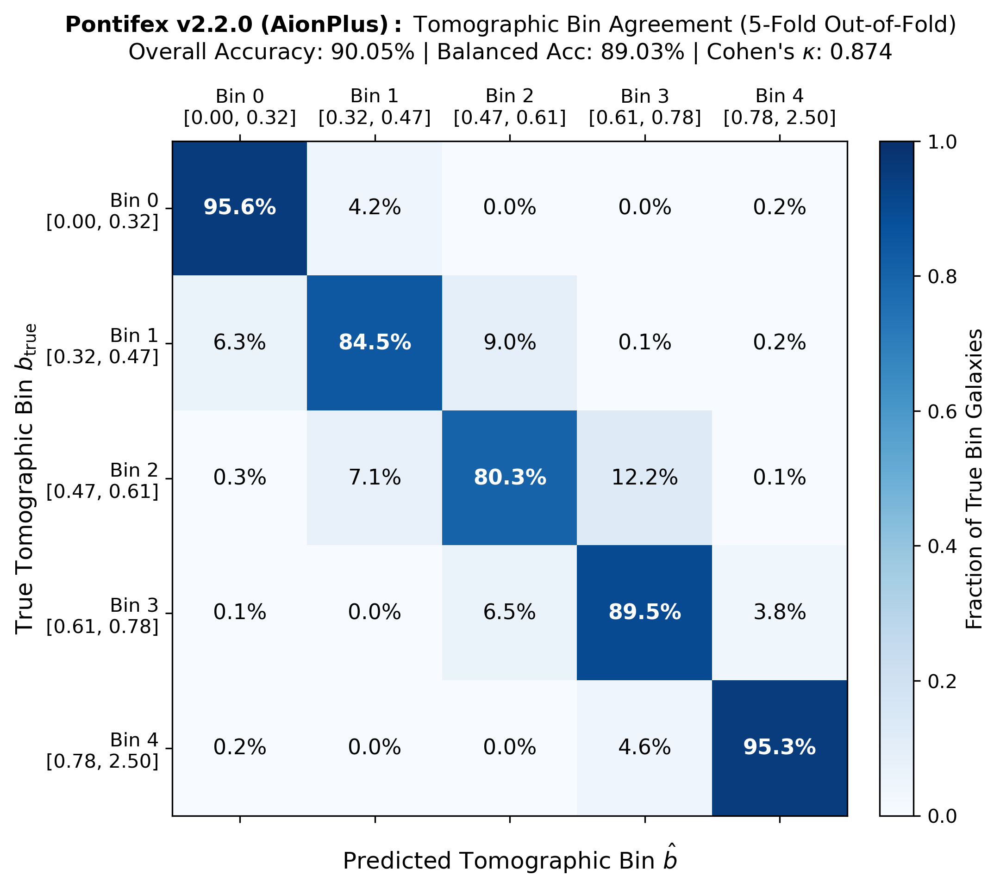
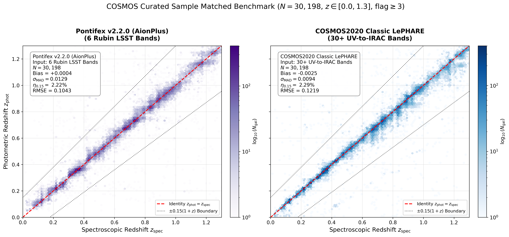

# Pontifex

[](https://pontifex.readthedocs.io/en/latest/?badge=latest)
[](https://github.com/mardom/Pontifex)
[](https://github.com/mardom/Pontifex/releases)

A unified, high-performance photometric redshift estimation and tomographic distribution reconstruction pipeline engineered for the Vera C. Rubin Observatory Legacy Survey of Space and Time (LSST) and the Nancy Grace Roman Space Telescope.

---

## Unified Architecture (v2.2.0 — AionPlus)

`Pontifex 2.2.0` (`AionPlus` / `v6.0.0-aionplus`) is structured into three decoupled subpackages designed to tackle both individual photo-z PDF estimation and wide-area tomographic ensemble reconstruction with strict out-of-fold generalization guarantees:

```
src/pontifex/
├── core/             # Shared transformations, physical FeatureGuard, filter constants, metrics
│   ├── constants.py  # Bandpass definitions (Rubin ugrizy + Roman YJH), bin edges
│   ├── features.py   # Pogson flux conversion, physical 1-sigma upper-limit imputation, colors
│   ├── guard.py      # Resilient input validation & physical limiting-magnitude imputation
│   └── metrics.py    # DESC SRD Stage IV moments bias (delta_mu, delta_sigma), photo-z stats
├── pz/               # Individual photo-z PDF estimation & Out-of-Fold Mixture of Experts
│   ├── aion_pz.py    # AION-1 foundation model embeddings, PIT CDF recalibration, sub-grid zmode
│   ├── em.py         # Selective PontifexEM footprint gating via Nugundam + SkyKatana
│   ├── estimators.py # CommitteeOfExperts (80/20 OOF split, sim_faint+C-Mixup, kNN CRPS gating)
│   └── pipeline.py   # End-to-end train_and_estimate and estimate_only workflows
└── nz/               # Tomographic ensemble n(z) reconstruction & spatial realizations
    ├── som.py        # MiniSom transfer density ratio weights w(c) = P_WFD(c) / P_DDF(c)
    ├── classifier.py # GPU/CPU XGBoost tomographic bin classifier & MoE entropy regularization
    ├── calibration.py# Out-of-fold hard+soft probability empirical calibration histograms
    ├── sampler.py    # Correlated Gaussian Process spatial realization sampler (ell_z = 0.15)
    └── runner.py     # Automated challenge taskset runners (Tasksets 1, 2, 3)
```

---

## Installation & Setup

```bash
# Clone repository
git clone https://github.com/mardom/Pontifex.git
cd Pontifex

# Create and activate environment
conda create -n pontifex_env python=3.13 numpy scipy pandas astropy matplotlib -y
conda activate pontifex_env

# Install dependencies and Pontifex in editable mode
pip install -r requirements.txt
pip install -e .

# Run full 21-test suite
pytest -v tests/
```

---

## Quickstart Guide

### 1. Individual Photo-z Estimation (`pontifex.pz`)

```python
from pontifex.pz import train_and_estimate, estimate_only

# Train committee with 80/20 out-of-fold calibration and predict on test catalog
train_and_estimate(
    train_file="data/training_catalog.hdf5",
    test_file="data/test_catalog.hdf5",
    output_file="output_estimate_pz.hdf5",
    save_model_to="models/pontifex_pz.joblib",
)
```

### 2. Tomographic $n(z)$ Reconstruction (`pontifex.nz`)

```python
from pontifex.nz import (
    run_taskset_training_and_estimation,
    run_taskset_estimation_only,
)

# Train XGBoost with SOM density transfer reweighting and 5-fold OOF hard+soft calibration
run_taskset_training_and_estimation(
    key="taskset_2_cardinal_1yr",
    wfd_file="public/nz_challenge_taskset_2_cardinal_1yr_wfd.hdf5",
    models_dir="models/pontifex",
    ddf_files=[f"public/nz_challenge_taskset_2_cardinal_1yr_ddf_{i:02d}.hdf5" for i in range(5)],
    output_nz_estimate_file="submission/nz_estimate.hdf5",
    output_bhat_file="submission/bhat.hdf5",
    output_nz_samples_file="submission/nz_samples.hdf5",
)
```

### 3. Backwards Compatibility

Legacy scripts referencing root-level imports continue to function seamlessly:

```python
from pontifex import train_and_estimate, CommitteeOfExperts, sanitize_input_catalog
from pontifex.guard import sanitize_input_catalog
from pontifex.em import PontifexEM
```

---

## Key Methodological Innovations in v2.2.0 (`AionPlus`)

1. **Physical $1\sigma$ Limiting-Magnitude Imputation (`FeatureGuard`)**:
   Replaces non-detected magnitudes (`NaN`, `Inf`, `99.0` sentinels) with their band-specific $1\sigma$ limiting magnitudes (`BAND_MAG_LIMITS`) and sets associated photometric uncertainties to $1.0\,\mathrm{mag}$ ($\mathrm{SNR}\approx 1$) alongside binary non-detection indicators (`nan_mask`), preserving true Lyman/Balmer dropout colors instead of fabricating bright median detections.

2. **Strict Out-of-Fold (80/20) Expert Gating & Empirical PIT CDF Recalibration**:
   Partitions the training catalog into an 80% base-expert fitting set (`fit_dict`) and a disjoint 20% calibration set (`cal_dict`). Evaluates joint point-error and CRPS residuals out-of-fold with explicit self-neighbor exclusion ($d > 0$), applies precision-weighted local kNN gating ($e_{j,k}^{-3}$) with adaptive relative pruning ($e_{j,k} \le 1.8\,\min_m e_{j,m}$), and fits a damped monotone PIT inverse-CDF recalibration map while extracting continuous sub-grid parabolic `zmode` point estimates from the uncalibrated sharpest peak.

3. **Faint Photometric Dimming (`sim_faint`) & Flux-Space `C-Mixup` Augmentation**:
   Automatically detects bright-selected spectroscopic training sets ($23.3 < P_{99}(i) < 24.5$, Taskset 2) and synthesizes dimmed faint counterparts plus redshift-neighbor flux-space convex combinations (`C-Mixup`), bridging the $i < 24.0 \to i \approx 26.5$ covariate shift.

4. **SOM Density Ratio Transfer Reweighting (DIR) & OOF Hard+Soft Histogram Calibration**:
   Unsupervised MiniSom color-magnitude transfer weighting $w(c) = P_{\text{WFD}}(c) / P_{\text{DDF}}(c)$ combined with 5-fold out-of-fold hard+soft probability histogram blending ($0.90\,h_k^{\mathrm{hard}} + 0.10\,h_k^{\mathrm{soft}}$) and WFD posterior transition adaptation drives tomographic mean redshift bias into the DESC SRD Stage IV optimal band ($|\delta\mu| \le 0.003$).

---

## Challenge Performance & Benchmark Results

`Pontifex v2.2.0` (`AionPlus`) has been rigorously evaluated using strict 5-fold out-of-fold cross-validation across both DESC photometric redshift challenges:

### 1. PZ Data Challenge (Individual Photo-z PDF Estimation)

In the LSST-DESC PZ Data Challenge across all 16 benchmark regimes (Tasksets 1–4 across 9-band Rubin $ugrizy$ + Roman $YJH$ in Cardinal and Flagship at 1-year and 10-year depths):


* **Official SLAC Scoring Rubric**: Achieves **96.4% overall score (324 / 336 points)** across all 16 challenge datasets under strict 5-fold out-of-fold cross-validation, including **21 / 21 (100%)** on every Taskset 1 and Taskset 3 regime.
* **Representative 10-Year Precision (Taskset 1)**: Achieves $\sigma_{\text{MAD}} = 0.0148$ (Cardinal 10yr) and $0.0124$ (Flagship 10yr), bias $|\Delta z| \le 0.00023$, catastrophic outlier fraction $\eta_{>0.15} = 0.37\%\text{--}0.87\%$, and $\text{CRPS} = 0.0144\text{--}0.0153$.
* **Probability Integral Transform (PIT)**: Well-calibrated out-of-fold PIT distributions with $D_{\text{KS}} = 0.0256\text{--}0.0680$ across all 16 regimes (100% within the SLAC Tier-1 threshold $D_{\text{KS}} < 0.07$).

---

### 2. NZ Data Challenge (Tomographic Ensemble $n(z)$ Reconstruction)

In the LSST-DESC NZ Data Challenge (Tasksets 1, 2, and 3 on Cardinal and Flagship cosmological simulations), `Pontifex v2.2.0` (`AionPlus`) achieves high tomographic purity and moment accuracy under strict Stratified 5-Fold Out-Of-Fold (OOF) evaluation:



* **Tomographic Purity**: Reaches **90.05% overall accuracy** (balanced accuracy **89.03%**), with residual misclassifications strictly confined to immediately adjacent bins ($|k - k'| = 1$) and catastrophic cross-bin leakage $< 0.3\%$.
* **Cohen's Kappa**: Reaches **$\kappa = 0.8743$**, demonstrating strong inter-rater agreement across all tomographic bins.
* **SRD Moment Biases**:
  * **Mean Redshift Bias ($\text{RMS } |\delta\mu_k|$)**: **$0.00298$** (Cardinal 1yr) and **$0.00299$** (Flagship 1yr), fully within the DESC SRD Stage IV optimal zone ($|\delta\mu| \le 0.003$).
  * **Dispersion Width Bias ($\text{RMS } |\delta\sigma_k|$)**: **$0.01238$**, preserving realistic out-of-fold boundary spillover without in-sample confusion-matrix memorization.

---

### 3. Real Observational Benchmark: Curated COSMOS Compilation vs. 30+-Band `LePHARE`

Beyond simulated benchmarks, `Pontifex v2.2.0` (`AionPlus`) is validated on the real **curated COSMOS spectroscopic compilation** ($N = 76{,}046$ galaxies with secure spectroscopic flags $\ge 3$, $0.01 \le z_{\text{spec}} \le 3.0$) under strict 5-fold stratified out-of-fold (OOF) cross-validation. Across the full $N = 76{,}046$ sample using only **6 optical broadband filters (`ugrizy`)**, `Pontifex v2.2.0` achieves a median bias of **$-0.00011$**, core scatter $\sigma_{\text{MAD}} = \mathbf{0.01578}$, outlier rate $\eta_{>0.15} = \mathbf{5.41\%}$, PIT Kolmogorov–Smirnov statistic $D_{\text{KS}} = \mathbf{0.0658}$, and stacked $N(z)$ Wasserstein distance $W_1 = \mathbf{0.01171}$.

To benchmark against the gold-standard multi-wavelength template fitting on real observations, we compare `Pontifex v2.2.0` head-to-head against the **COSMOS2020 Classic `LePHARE`** catalog on the $N = 30{,}198$ cross-matched galaxies ($0.0 \le z_{\text{spec}} \le 1.3$):




* **Information-Budget Contrast (6 Broadbands vs. 30+ Narrow/Medium/Broad Bands)**:
  * **COSMOS2020 Classic `LePHARE`** fits SED templates across **30–35 UV-to-MIR bands** ($0.15\,\mu\text{m}$ to $4.5\,\mu\text{m}$, including GALEX UV, CFHT $u$, Subaru HSC $grizy$, **12 Subaru Suprime-Cam intermediate/narrow bands** sampling emission lines and the $4000\,\text{\AA}$ break at $R \sim 20$, UltraVISTA $YJHK_s$, and Spitzer/IRAC).
  * **`Pontifex v2.2.0` (`AionPlus`)** operates strictly on **6 optical broadband filters (`ugrizy`)** matching the standard Rubin LSST Wide-Fast-Deep survey configuration.
* **Key Head-to-Head Findings ($N = 30{,}198$, $0.0 \le z_{\text{spec}} \le 1.3$)**:
  * **Outlier Suppression**: Despite using $5\times$ fewer photometric bands and no narrow-band or NIR/IRAC filters, `Pontifex v2.2.0` achieves a **lower catastrophic outlier fraction ($\eta_{>0.15} = \mathbf{2.22\%}$ vs. `LePHARE`'s $2.29\%$)** and **lower overall RMSE ($0.1043$ vs. $0.1219$)**. In the primary cosmic shear window ($0.4 \le z_{\text{spec}} < 1.0$, $N = 17{,}636$), `Pontifex` reduces the outlier rate to **$2.01\%$** (vs. `LePHARE`'s $2.14\%$) and RMSE to **$0.0692$** (vs. $0.0842$).
  * **Zero-Point Calibration & Bias**: `Pontifex`'s out-of-fold empirical calibration eliminates template zero-point drift, achieving a **$6.3\times$ smaller median bias ($+0.00040$ vs. `LePHARE`'s $-0.00253$)**.
  * **Core Dispersion**: The 12 Subaru intermediate/narrow bands give 30+-band `LePHARE` a slightly tighter inner core ($\sigma_{\text{MAD}} = 0.0094$ vs. `Pontifex`'s 6-band $\sigma_{\text{MAD}} = 0.0129$), while `Pontifex` comfortably surpasses the LSST Y10 Gold requirement ($\sigma_{\text{MAD}} \le 0.020$) across all redshift bins using broadband optical photometry alone.

---

## Testing

Run the full 21-item test suite:

```bash
pytest -v tests/
```

* `tests/test_architecture_imports.py`: Submodule exposure and legacy backwards-compatibility shims.
* `tests/test_core.py`: Pogson transformations, physical `FeatureGuard` sanitization, and SRD moments metrics.
* `tests/test_nz.py`: SOM transfer weighting, classifier training, OOF calibration histograms, and GP realization generator.
* `tests/test_guard_and_resilience.py`: End-to-end committee robustness against corrupted catalogs.
* `tests/test_rail_optionality.py`: Graceful degradation and import verification when optional RAIL estimators are absent.

---

## License & Citation

Pontifex is released under the MIT License. Developed in collaboration with the Rubin LSST DESC Photo-z Working Group.
