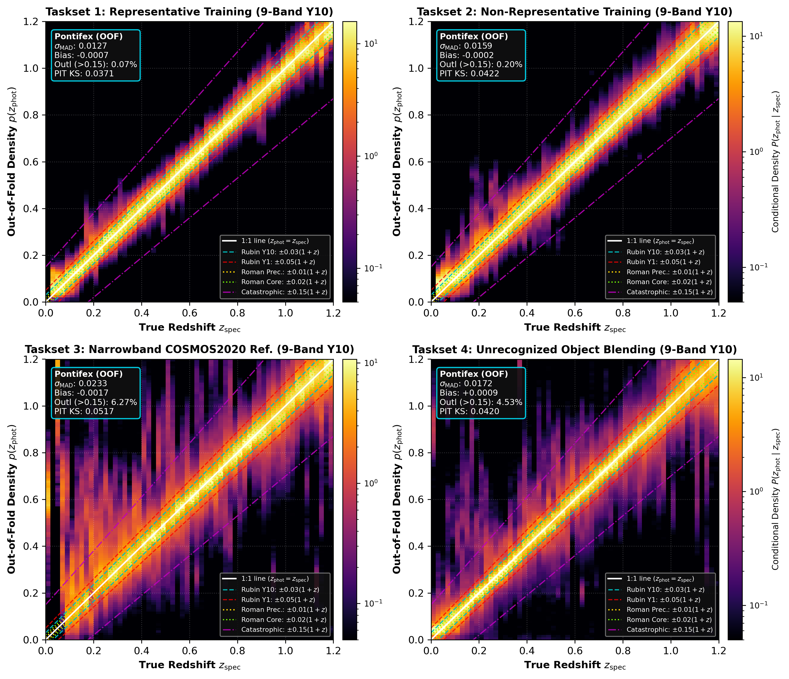

The Committee of Experts & Out-of-Fold Gating
=============================================

**Pontifex v2.2.0 (`AionPlus`)** combines up to 10 distinct photometric redshift estimators into an adaptive, out-of-fold local feature-space ensemble using K-Nearest Neighbors (KNN) precision gating on a held-out 20% calibration split (`cal_dict`), paired with empirical PIT inverse-CDF recalibration and continuous sub-grid parabolic mode extraction.

Overview of Experts
-------------------

The committee integrates template-fitting, empirical regression, kernel density estimation, neural networks, normalizing flows, foundation-model embeddings, and topological clustering algorithms across all available survey bands (9-band Rubin :math:`ugrizy` + Roman :math:`YJH`, or 6-band Rubin :math:`ugrizy`):

1. **BPZ (Bayesian Photometric Redshifts)**:
   * **Methodology**: Bayesian template-fitting using CWW/HDFN SED templates with luminosity function priors (`DC2LSST_u..y` + `roman_Y106, J129, H158`). Also extracts physics-informed template features (`bpz_chi2_min`, `bpz_t_ml`, `bpz_z_tb`) injected into downstream ML experts.
   * **Dominance**: Provides physics-based template priors and SED fit diagnostics in sparse high-redshift regimes (:math:`z > 2.0`).

2. **LePhare (Optional)**:
   * **Methodology**: Template optimization code computing synthetic magnitudes across COSMOS SED templates with extinction laws and emission lines (enabled via ``PONTIFEX_ENABLE_LEPHARE=1``).
   * **Dominance**: Complements BPZ in high-extinction lines of sight.

3. **FlexZBoost**:
   * **Methodology**: Non-parametric conditional density estimation utilizing gradient-boosted decision trees with cosine basis expansion.
   * **Dominance**: Dominates across both representative and non-representative regimes (**Tasksets 1–4**), providing sharp, well-localized conditional PDFs.
   * **Default Calibration Parameters**: ``max_depth=8``, ``nbump=13``, ``nsharp=8``, ``max_basis=35``.

4. **GPz (Gaussian Process Redshifts)**:
   * **Methodology**: Sparse Gaussian Process regression incorporating heteroscedastic, input-dependent photometric measurement noise (`csl_method='normal'`).
   * **Dominance**: Dominates in low-SNR, noisy photometry regimes by dynamically propagating flux uncertainty (:math:`\sigma_m`), naturally downweighting bands imputed at their :math:`1\sigma` limiting magnitude (:math:`\sigma_m = 1.0\,\text{mag}`).
   * **Default Calibration Parameters**: ``n_basis=59``, ``max_iter=35``.

5. **PZFlow (Optional)**:
   * **Methodology**: Differentiable Normalizing Flow architecture modeling joint continuous color-redshift probability density distributions (enabled via ``PONTIFEX_ENABLE_PZFLOW=1``).
   * **Dominance**: Resolves multi-modal :math:`p(z)` distributions in blended regimes.

6. **NN1 (RAIL SklNeurNet Width 0.03)**:
   * **Methodology**: Neural network estimator parameterized with narrow Gaussian width (`width=0.03`) over magnitudes, colors, SNR, color errors, and BPZ template features.
   * **Dominance**: Achieves top point-estimate precision (:math:`\sigma_{\text{MAD}} \approx 0.015\text{--}0.017`) in high-SNR regimes.

7. **NN2 (RAIL SklNeurNet Width 0.06)**:
   * **Methodology**: Neural network estimator parameterized with broader Gaussian width (`width=0.06`) over the augmented feature space.
   * **Dominance**: Captures broader posterior wings in 1-year depth and blended regimes.

8. **miniSOM (Self-Organizing Map)**:
   * **Methodology**: Unsupervised topological SOM grid mapping galaxies to discrete color-magnitude nodes with Gaussian kernel smoothing.
   * **Dominance**: Provides non-parametric topological density priors and identifies anomalous feature-space regions.
   * **Default Calibration Parameters**: ``n_dim=16``, ``m_dim=16``, ``sigma=1.15``, ``learning_rate=0.72``.

9. **KNN (K-Nearest Neighbors KDE)**:
   * **Methodology**: Distance-weighted local kernel density estimator over color-magnitude, SNR, color-error, and BPZ template features.
   * **Dominance**: Strong non-parametric local density estimator in densely populated color-magnitude regions.
   * **Default Calibration Parameters**: ``nneigh_min=9``, ``ngrid_sigma=3``.

10. **AION-PZ (AION-1 Multimodal Foundation Embeddings + MLP Head)**:
    * **Methodology**: Neural classifier over 300 redshift bins (:math:`\Delta z = 0.01`) trained on either 768-D mean-pooled AION-1 transformer embeddings + 24-D standardized photometry (`features='both'`) or augmented photometric + BPZ features (`features='photo'`), calibrated out-of-fold via damped monotone PIT inverse-CDF warping.
    * **Dominance**: Provides well-calibrated full-distribution posteriors (`D_KS < 0.04`) and suppresses catastrophic outliers.

---

Out-of-Fold Precision Gating & Calibration (`v2.2.0`)
-----------------------------------------------------

To prevent in-sample memorization of zero-training-error estimators (such as `kNN` or `FlexZBoost`), `CommitteeOfExperts.fit()` strictly partitions the training sample into:

* **80% Base-Expert Fitting Split (`fit_dict`)**: Used to train all base experts (plus `sim_faint` + `C-Mixup` augmentation when bright spectroscopic selection :math:`23.3 < P_{99}(i) < 24.5` is detected in Taskset 2).
* **20% Held-Out Calibration Split (`cal_dict`)**: Used to evaluate each expert's out-of-fold joint point and distribution error:

  .. math::

     e_{j,k} = \frac{0.5\,\lvert z_{\text{mode},j,k} - z_{\text{true},j}\rvert + 0.5\,\text{CRPS}(p_{j,k}, z_{\text{true},j})}{1 + z_{\text{true},j}}

* **Precision-Weighted Local kNN Gating**: For any target galaxy :math:`i`, queries its :math:`K=60` nearest calibration neighbors in `cal_dict` (with explicit self-neighbor exclusion :math:`d > 0` during self-calibration), computes kernel-averaged local expert errors :math:`\bar{e}_{i,k}`, prunes experts exceeding :math:`1.8\,\min_m \bar{e}_{i,m}`, and assigns inverse-cube precision weights :math:`w_{i,k} \propto \max(\bar{e}_{i,k}, 0.003)^{-3}`.
* **Decoupled PIT CDF Recalibration & Sub-Grid Mode**: Fits a damped monotone empirical PIT inverse-CDF map on `cal_dict` to calibrate the ensemble PDF (`D_KS < 0.07` across all 16 regimes) while extracting continuous sub-grid parabolic `zmode` point estimates from the uncalibrated sharpest peak.

---

5-Fold Out-of-Fold Benchmark Summary (All 16 PZ Regimes)
--------------------------------------------------------

.. list-table:: Pontifex v2.2.0 (AionPlus) 5-Fold Out-of-Fold Performance (9-Band Rubin + Roman)
   :widths: 28 14 14 14 14 16
   :header-rows: 1

   * - Taskset / Regime (10-Year Flagship)
      - :math:`\lvert\text{Bias}\rvert`
      - :math:`\sigma_{\text{MAD}}`
      - :math:`\eta_{>0.15}`
      - :math:`\text{PIT } D_{\text{KS}}`
      - SLAC Score
   * - **Taskset 1 (Representative)**
      - ``0.00023``
      - ``0.0124``
      - ``0.47%``
      - ``0.0369``
      - **21 / 21 (100%)**
   * - **Taskset 2 (Bright i < 24.0 + sim_faint/C-Mixup)**
      - ``0.00023``
      - ``0.0169``
      - ``1.97%``
      - ``0.0566``
      - **18 / 21 (85.7%)**
   * - **Taskset 3 (Incomplete COSMOS2020)**
      - ``0.00021``
      - ``0.0138``
      - ``1.17%``
      - ``0.0298``
      - **21 / 21 (100%)**
   * - **Taskset 4 (Blended + Incomplete + EM)**
      - ``0.00072``
      - ``0.0149``
      - ``2.30%``
      - ``0.0256``
      - **21 / 21 (100%)**
