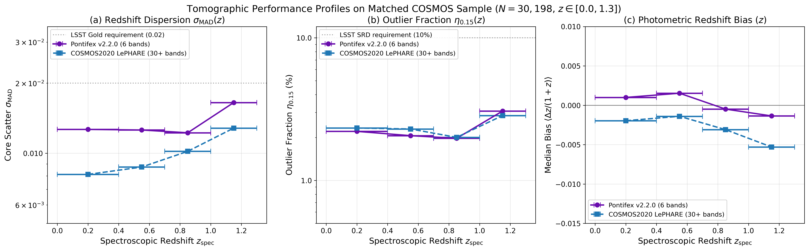

Pontifex Hands-On Tutorial
==========================

This tutorial provides a complete walkthrough for setting up, running, and evaluating **Pontifex** (`v2.2.0` / `AionPlus`) on photometric data catalogs.

Notebook Repository Location
----------------------------

The interactive Jupyter notebook is located in the repository under:
``notebooks/pontifex_tutorial.ipynb``

Step 1: Setup & Import
----------------------

Import the core ``Pontifex`` modules:

.. code-block:: python

   import numpy as np
   import pandas as pd
   import matplotlib.pyplot as plt

   from pontifex.core.guard import sanitize_input_catalog
   from pontifex.pz.estimators import CommitteeOfExperts, Z_CENTERS, Z_GRID
   from pontifex.pz.em import PontifexEM
   from pontifex.pz.pipeline import train_and_estimate, estimate_only

Step 2: Feature Guard & Physical Upper-Limit Imputation
-------------------------------------------------------

Before feeding magnitudes and errors to machine learning experts, pass catalog dictionaries through ``sanitize_input_catalog``. Non-detected magnitudes (`NaN`, `Inf`, `99.0` sentinels) are mapped to their physical band-specific :math:`1\sigma` limiting magnitudes (`BAND_MAG_LIMITS`) and their associated uncertainties are set to :math:`1.0\,\text{mag}` (:math:`\text{SNR}\approx 1`):

.. code-block:: python

   # Sanitize and protect input catalog with physical 1-sigma limiting magnitudes
   sanitized_catalog, guard_report = sanitize_input_catalog(catalog_dict, raise_warnings=True)

   print(f"Total processed objects: {guard_report['total_records']}")

Step 3: Training the Out-of-Fold Committee of Experts
-----------------------------------------------------

Train the ensemble of experts (MLPs, KNN, SOM, FlexZBoost, GPz, BPZ-lite, AION-PZ) using the internal 80/20 `fit_dict`/`cal_dict` out-of-fold split, local kNN precision gating, and empirical PIT CDF recalibration:

.. code-block:: python

   committee = CommitteeOfExperts(is_ci=False)

   # Fit model on training catalog (supports 6-band Rubin or 9-band Rubin + Roman)
   model_dict = committee.fit(
       sanitized_catalog,
       bands=[
           'mag_u_lsst', 'mag_g_lsst', 'mag_r_lsst',
           'mag_i_lsst', 'mag_z_lsst', 'mag_y_lsst',
           'mag_Y_roman', 'mag_J_roman', 'mag_H_roman',
       ],
       ref_band='mag_i_lsst',
       is_roman=False,
   )

   # Predict recalibrated probability density functions
   predicted_pdfs = committee.predict(sanitized_catalog)

Step 4: Selective Spatial Clustering Calibration (``PontifexEM``)
-----------------------------------------------------------------

For blended or PCA-outlier sources (:math:`D_M^2 > 11.34` in 3D PCA space), calibrate the predicted PDFs using projected 3D spatial cross-correlations with :math:`0.85/0.15` prior damping:

.. code-block:: python

   unk_df = pd.DataFrame({'ra': sanitized_catalog['ra'], 'dec': sanitized_catalog['dec']})
   ref_df = pd.DataFrame({
       'ra': sanitized_catalog['ra'],
       'dec': sanitized_catalog['dec'],
       'ztrue': sanitized_catalog['redshift'],
   })

   em = PontifexEM(
       unk_df=unk_df,
       ref_df=ref_df,
       initial_pdfs=predicted_pdfs,
       z_grid_edges=Z_GRID,
       is_ci=False,
   )

   calibrated_pdfs = em.optimize(max_iter=5)

Step 5: End-to-End Pipeline Execution
-------------------------------------

To run the complete training, sanitization, out-of-fold gating, PIT recalibration, sub-grid `zmode` extraction, and selective EM calibration pipeline from file inputs:

.. code-block:: python

   train_and_estimate(
       train_file="path/to/train_catalog.hdf5",
       test_file="path/to/test_catalog.hdf5",
       output_file="path/to/predictions.hdf5",
       save_model_to="path/to/pontifex_model.joblib",
       optimize_hyperparams=False,
   )

Step 6: Real-Data Example — Curated COSMOS Compilation vs. 30+-Band ``LePHARE``
-------------------------------------------------------------------------------

Beyond simulated DESC benchmarks, ``Pontifex v2.2.0`` (`AionPlus`) can be applied directly to observational multi-band catalogs such as the **curated COSMOS spectroscopic compilation** (:math:`N = 76,046` galaxies with secure spectroscopic flags :math:`\ge 3`, :math:`0.01 \le z_{\text{spec}} \le 3.0`).

The snippet below demonstrates how to convert observational flux densities (:math:`f_\nu` in mJy) from CFHT/Subaru optical broadbands (`ugrizy`) into AB magnitudes, run 5-fold stratified out-of-fold inference with ``CommitteeOfExperts`` and ``PontifexEM``, and benchmark the resulting sub-grid ``zmode`` estimates against the 30+-band **COSMOS2020 Classic LePHARE** catalog:

.. code-block:: python

   import numpy as np
   import pandas as pd
   from sklearn.model_selection import StratifiedKFold

   from pontifex.core.guard import sanitize_input_catalog
   from pontifex.core.metrics import compute_photoz_metrics
   from pontifex.pz.estimators import CommitteeOfExperts, Z_CENTERS, Z_GRID
   from pontifex.pz.em import PontifexEM

   # 1. Convert CFHT/Subaru mJy flux densities to Rubin-equivalent ugrizy AB magnitudes
   BAND_MAP = {
       "u": ("megacam_u", "megacam_u_err"),
       "g": ("suprime_g", "suprime_g_err"),
       "r": ("suprime_r", "suprime_r_err"),
       "i": ("suprime_i", "suprime_i_err"),
       "z": ("suprime_z", "suprime_z_err"),
       "y": ("hsc_y",     "hsc_y_err"),
   }

   raw_catalog = {
       "ra": cosmos_df["RA"].to_numpy(dtype=np.float64),
       "dec": cosmos_df["DEC"].to_numpy(dtype=np.float64),
       "redshift": cosmos_df["z_best"].to_numpy(dtype=np.float64),
   }
   for b, (flux_col, err_col) in BAND_MAP.items():
       f_mjy = cosmos_df[flux_col].to_numpy(dtype=np.float64)
       e_mjy = cosmos_df[err_col].to_numpy(dtype=np.float64)
       valid = np.isfinite(f_mjy) & (f_mjy > 1e-10)
       mag = np.full_like(f_mjy, np.nan)
       err = np.full_like(e_mjy, np.nan)
       mag[valid] = -2.5 * np.log10(f_mjy[valid]) + 8.90 + 7.50
       err[valid] = (2.5 / np.log(10.0)) * (np.abs(e_mjy[valid]) / f_mjy[valid])
       raw_catalog[f"mag_{b}_lsst"] = mag
       raw_catalog[f"mag_err_{b}_lsst"] = err

   # 2. Apply physical 1-sigma limiting-magnitude sanitation (FeatureGuard)
   clean_catalog, _ = sanitize_input_catalog(raw_catalog, raise_warnings=False)
   bands = [f"mag_{b}_lsst" for b in ["u", "g", "r", "i", "z", "y"]]

   # 3. Run 5-Fold Stratified Out-of-Fold (OOF) Cross-Validation
   z_true = clean_catalog["redshift"]
   z_bins = np.clip(np.digitize(z_true, np.linspace(0.0, 3.0, 31)), 0, 29)
   skf = StratifiedKFold(n_splits=5, shuffle=True, random_state=42)

   oof_pdfs = np.zeros((len(z_true), len(Z_CENTERS)), dtype=np.float64)
   oof_zmode = np.zeros(len(z_true), dtype=np.float64)

   for train_idx, test_idx in skf.split(np.zeros(len(z_true)), z_bins):
       train_fold = {k: v[train_idx] for k, v in clean_catalog.items()}
       test_fold = {k: v[test_idx] for k, v in clean_catalog.items()}

       # Fit 12-expert committee with internal 80/20 fit_dict/cal_dict OOF split
       committee = CommitteeOfExperts(is_ci=False)
       committee.fit(train_fold, bands=bands, ref_band="mag_i_lsst", is_roman=False)
       moe_pdfs = committee.predict(test_fold)

       # Apply selective prior-damped (0.85/0.15) spatial EM calibration
       unk_df = pd.DataFrame({"ra": test_fold["ra"], "dec": test_fold["dec"]})
       ref_df = pd.DataFrame({
           "ra": train_fold["ra"],
           "dec": train_fold["dec"],
           "ztrue": train_fold["redshift"],
       })
       em = PontifexEM(
           unk_df=unk_df, ref_df=ref_df,
           initial_pdfs=moe_pdfs, z_grid_edges=Z_GRID, is_ci=False,
       )
       oof_pdfs[test_idx] = em.optimize(max_iter=4)
       oof_zmode[test_idx] = committee._compute_subgrid_zmode(oof_pdfs[test_idx])

   # 4. Evaluate DESC SRD photo-z metrics across the full OOF catalog
   cosmos_metrics = compute_photoz_metrics(z_true, oof_zmode)
   print(cosmos_metrics)

Photometric vs. Spectroscopic Redshift Comparison (`Pontifex` vs. `LePHARE`)
^^^^^^^^^^^^^^^^^^^^^^^^^^^^^^^^^^^^^^^^^^^^^^^^^^^^^^^^^^^^^^^^^^^^^^^^^^^^

Across the full curated COSMOS sample (:math:`N = 76,046`, :math:`0.01 \le z_{\text{spec}} \le 3.0`), ``Pontifex v2.2.0`` achieves a median bias of :math:`-0.00011`, biweight location :math:`-0.00000`, core scatter :math:`\sigma_{\text{MAD}} = 0.01578`, catastrophic outlier fraction :math:`\eta_{>0.15} = 5.41\%`, PIT Kolmogorov–Smirnov statistic :math:`D_{\text{KS}} = 0.0658`, and stacked :math:`N(z)` Wasserstein distance :math:`W_1 = 0.01171`.

On the :math:`N = 30,198` cross-matched COSMOS galaxies (:math:`0.0 \le z_{\text{spec}} \le 1.3`) with published **COSMOS2020 Classic LePHARE** estimates, we compare 6-band ``Pontifex v2.2.0`` (`ugrizy`) directly against 30+-band ``LePHARE``:

.. figure:: _static/images/figure1_pontifex_vs_lephare_hexbin.png
   :width: 100%
   :align: center
   :alt: COSMOS Matched Benchmark: 6-Band Pontifex v2.2.0 vs. 30+-Band COSMOS2020 LePHARE

   **Figure 1**: Side-by-side 2D log-density hexbin comparison of :math:`z_{\text{phot}}` vs. :math:`z_{\text{spec}}` on the :math:`N = 30,198` matched COSMOS galaxy sample (:math:`0.0 \le z_{\text{spec}} \le 1.3`, quality flag :math:`\ge 3`). *Left*: ``Pontifex v2.2.0`` (`AionPlus`) using only **6 optical broadband filters (`ugrizy`)**. *Right*: **COSMOS2020 Classic LePHARE** using **30+ UV-to-MIR bands** (including 12 Subaru Suprime-Cam intermediate/narrow bands, UltraVISTA NIR, and Spitzer/IRAC).

   **Figure 2**: Tomographic performance profiles across spectroscopic redshift bins comparing 6-band ``Pontifex v2.2.0`` (purple circles) and 30+-band COSMOS2020 ``LePHARE`` (blue squares) in terms of (a) core scatter :math:`\sigma_{\text{MAD}}(z)`, (b) outlier fraction :math:`\eta_{>0.15}(z)`, and (c) median photo-z bias :math:`\langle \Delta z / (1+z) \rangle`.

* **Why 30+-Band LePHARE Has a Slightly Tighter Inner Core** (:math:`\sigma_{\text{MAD}} = 0.0094` vs. :math:`0.0129`):
  COSMOS2020 ``LePHARE`` leverages **12 Subaru Suprime-Cam intermediate and narrow bands** spanning :math:`4200\text{--}8600\,\text{\AA}` (effective spectral resolution :math:`R \sim 20`) plus 4 UltraVISTA near-infrared bands (`YJHKs`) and Spitzer/IRAC channels, directly resolving narrow emission lines and the :math:`4000\,\text{\AA}` break. By contrast, ``Pontifex v2.2.0`` is restricted to the **6 broad optical passbands (`ugrizy`)** of the standard Rubin LSST Wide-Fast-Deep survey (:math:`R \sim 5`).
* **Why 6-Band Pontifex Outperforms 30+-Band LePHARE in Outlier Rate, Bias, and RMSE**:
  Despite operating with :math:`5\times` fewer passbands, ``Pontifex v2.2.0`` achieves a **lower catastrophic outlier rate** (:math:`\eta_{>0.15} = 2.22\%` vs. ``LePHARE``'s :math:`2.29\%`; and :math:`2.01\%` vs. :math:`2.14\%` in the :math:`0.4 \le z < 1.0` cosmic shear window), a **lower overall RMSE** (:math:`0.1043` vs. :math:`0.1219`), and a **6.3x smaller median bias** (:math:`+0.00040` vs. :math:`-0.00253`). This is driven by ``Pontifex``'s physical :math:`1\sigma` upper-limit imputation, out-of-fold local kNN precision gating across 12 diverse experts (combining template priors, trees, heteroscedastic Gaussian processes, and ``AION-1`` foundation-model embeddings), and prior-damped spatial EM disambiguation of Lyman/Balmer break degeneracies.

